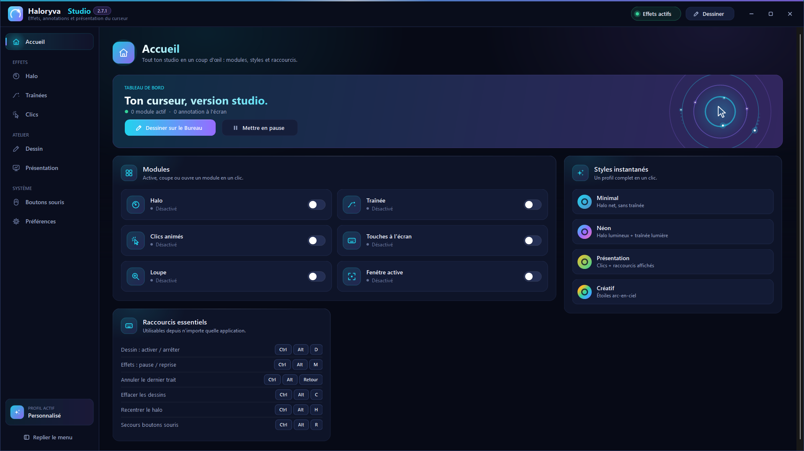

# Haloryva Studio

**Version 2.7.1 — Windows x64** · Créé par Julien Lecomte.

[Français](docs/fr/README.md) · [English](docs/en/README.md) · [Español](docs/es/README.md)

Rendez votre curseur visible et annotez votre écran pendant vos présentations : halo, traînées, effets de clic, dix outils de dessin et actions personnalisées sur les boutons de souris.

## Télécharger

**Haloryva Studio 2.7.1 est disponible gratuitement sur Microsoft Store**, le canal principal de téléchargement.

[Télécharger sur Microsoft Store](https://apps.microsoft.com/detail/9NJ14SZJP55B) — fiche publique accessible en France le 14 novembre 2026 ; la disponibilité peut varier selon le pays et l’appareil.

Aucun installateur EXE 2.7.1 n’est proposé ici. Les versions antérieures dans les releases sont historiques et ne constituent pas le téléchargement recommandé de la 2.7.1.

Consultez la [notice Store](docs/INSTALLATION.md) pour l’installation, la reprise des réglages, les mises à jour et la désinstallation.

## Fonctionnalités

- Halo, traînées et effets de clic personnalisables.
- Dix outils d’annotation, lissage, formes assistées, annuler/rétablir et export PNG transparent.
- Liste personnelle d’outils parcourus par les boutons de souris, avec appuis courts et longs.
- Loupe, focus, affichage des raccourcis et profils JSON locaux.
- Français, anglais et espagnol, avec langue mémorisée.

[Nouveautés 2.7.1](docs/fr/NOUVEAUTES.md) · [Historique](CHANGELOG.md)

## Installation et réglages

Clavier et souris requis. Le paquet Store x64 déclare Windows 10.0.26200.0 comme minimum. La cible retenue est Windows 11 25H2/26H2 sur PC Intel/AMD ; les essais ne qualifient pas toutes les combinaisons de systèmes et matériels.

Sauvegardez vos profils et ressources personnelles avant de changer de canal. Quittez l’ancienne version avant d’ouvrir la nouvelle. Si vous conservez deux installations, gardez un seul démarrage automatique. Fermer le Studio peut laisser les effets actifs ; utilisez Quitter Haloryva près de l’horloge pour sortir complètement.

## Assistance et confidentialité

- [Assistance publique](docs/fr/SUPPORT.md) et [GitHub Issues](https://github.com/JulienLecomteGit/haloryva-studio/issues).
- [Politique de confidentialité FR/EN/ES](docs/confidentialite/README.md).

Les tickets sont publics : ne joignez ni profil personnel complet, ni journal non relu, ni capture contenant des données privées. Aucun canal de support privé n’est actuellement proposé.

## Code, versions et droits

La documentation décrit la version Store 2.7.1. Cette branche intègre les 36 fichiers applicatifs estampillés de l’archive de fabrication du binaire 2.7.1.11, sans les modifier. Les sources de l’installateur et ses tests de maintenance restent historiques et ne sont pas présentés comme ceux de l’installateur final 2.7.1. Voir la [provenance et les limites de cette intégration](docs/SOURCES-2.7.1.11.md).

Version affichée : 2.7.1 ; version du fichier validé : 2.7.1.11 ; paquet Store : 2.7.1.0 x64. La certification et les essais utilisateur acquis sont décrits avec leurs limites dans [Diffusion et transparence](docs/DIFFUSION.md).

**© 2026 Julien Lecomte — tous droits réservés.** La visibilité publique du dépôt n’accorde pas de licence générale de modification ou de redistribution. Les droits actuels restent inchangés.
