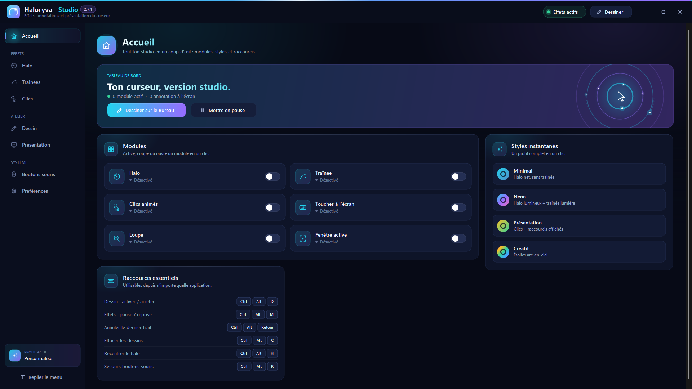

# Haloryva Studio

**Version 2.7.2 — Windows x64 · publication Store en attente** · Créé par Julien Lecomte.

[Français](docs/fr/README.md) · [English](docs/en/README.md) · [Español](docs/es/README.md)

Rendez votre curseur visible et annotez votre écran pendant vos présentations : halo, traînées, effets de clic, dix outils de dessin et actions personnalisées sur les boutons de souris.

## État de la mise à jour

La version 2.7.2 reprend le moteur de la copie expérimentale exp4, dont la compilation, les autotests et une recette visuelle ont réussi le 18 novembre 2026. Les maillons de la traînée Ligne / Lumière n’ont plus été perçus pendant cet essai.

**La fabrication Windows de qualification a réussi : binaire 2.7.2.6 compilé, suites natives réussies et structure du paquet MSIX 2.7.2.0 contrôlée.** [Preuve du run de qualification](https://github.com/JulienLecomteGit/haloryva-studio/actions/runs/44298963756). Le paquet est non signé, non installé et **la 2.7.2 n’est pas encore soumise ni certifiée par Microsoft Store**. Le contrôle du paquet ne remplace pas la certification Microsoft ni un essai de mise à jour sur un PC.

[État de validation 2.7.2](docs/VALIDATION-2.7.2.md) · [Provenance des sources](docs/SOURCES-2.7.2.md) · [Diffusion](docs/DIFFUSION.md) · [Dernières fabrications main](https://github.com/JulienLecomteGit/haloryva-studio/actions/workflows/haloryva-2.7.2.yml?query=branch%3Amain)

## Télécharger

**Microsoft Store est le canal principal gratuit.** La dernière publication documentée est la 2.7.1 ; la version effectivement proposée dépend de l’état de diffusion, du pays et de l’appareil.

[Télécharger sur Microsoft Store](https://apps.microsoft.com/detail/9NJ14SZJP55B)

Aucun installateur EXE 2.7.2 n’est proposé ici. Les fichiers des anciennes releases sont historiques et ne constituent pas la mise à jour Store. Consultez la [notice Store](docs/INSTALLATION.md) pour l’installation, la conservation des réglages, les mises à jour et la désinstallation.

## Fonctionnalités

- Halo, traînées et effets de clic personnalisables.
- Traînée continue en Ligne / Lumière, courbes adaptatives, extinction progressive et réglages expliqués.
- Dix outils d’annotation, lissage, formes assistées, annuler/rétablir et export PNG transparent.
- Liste personnelle d’outils parcourus par les boutons de souris, avec appuis courts et longs.
- Loupe, focus, affichage des raccourcis et profils JSON locaux.
- Français, anglais et espagnol, avec langue mémorisée.

[Nouveautés 2.7.2](docs/fr/NOUVEAUTES.md) · [Historique](CHANGELOG.md)

*Capture réelle conservée de la version 2.7.1. Elle illustre le Studio ; elle ne constitue pas une capture ni une preuve de publication de la 2.7.2.*

## Installation et réglages

Clavier et souris requis. Le canal Store vise les PC Windows x64 Intel/AMD. Les exigences déclarées du paquet et les limites des essais figurent dans la [notice d’installation](docs/fr/INSTALLATION.md).

Pour mettre à jour une installation Store, utilisez Microsoft Store. Une nouvelle compilation de test ne remplace pas automatiquement l’application installée. Conservez une sauvegarde de vos profils et ressources personnelles avant tout changement de canal ou désinstallation. Fermer le Studio peut laisser les effets actifs ; utilisez Quitter Haloryva près de l’horloge pour sortir complètement.

## Assistance et confidentialité

- [Assistance publique](docs/fr/SUPPORT.md) et [GitHub Issues](https://github.com/JulienLecomteGit/haloryva-studio/issues).
- [Politique de confidentialité FR/EN/ES](docs/confidentialite/README.md).

Un journal technique local et borné accompagne la récupération des effets. Les diagnostics détaillés restent facultatifs et ne sont pas envoyés automatiquement. Les tickets sont publics : ne joignez ni profil personnel complet, ni journal non relu, ni capture contenant des données privées. Aucun canal de support privé n’est actuellement proposé.

## Code, versions et droits

Identités contrôlées pendant la qualification 2.7.2 : version affichée **2.7.2**, fichier **2.7.2.6**, assembly **2.7.2.0**, paquet Store cible **2.7.2.0 x64**. Les sources de diffusion conservent le moteur validé d’exp4 ; les changements de promotion et leurs limites sont décrits dans [SOURCES-2.7.2.md](docs/SOURCES-2.7.2.md).

La [provenance historique 2.7.1.11](docs/SOURCES-2.7.1.11.md) reste disponible. Les anciens dossiers d’installateur et de maintenance ne sont pas présentés comme un installateur EXE final 2.7.2.

**© 2026 Julien Lecomte — tous droits réservés.** La visibilité publique du dépôt n’accorde pas de licence générale de modification ou de redistribution. Les droits actuels restent inchangés.
