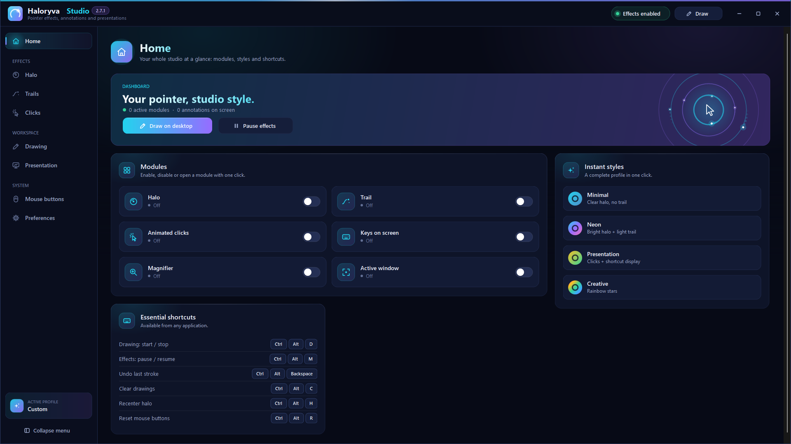

# Haloryva Studio 2.7.1

[Français](../fr/README.md) · [Home](../../README.md) · [Español](../es/README.md)

Make your pointer easy to follow and annotate your screen during presentations.

Haloryva Studio helps you guide attention during a demo, a lesson or a presentation. Customize the pointer halo, trails and click effects, then draw directly on your screen.

Choose from ten tools: pen, highlighter, line, rectangle, ellipse, arrow, freehand arrow, auto shapes, number and text. Adjust color, thickness and smoothing, undo or redo a stroke, and export your annotations as a PNG with a transparent background.

Assign actions to your mouse buttons for both short clicks and long presses. Choose which drawing tools the buttons cycle through: select two favorites to switch between them without cycling through the full list.

The Studio brings together presentation settings, a magnifier, a focus effect and shortcut display. Profiles are saved locally and can be exported or imported as JSON. After you close the Studio window, the app can remain available from its icon near the clock.

Choose French, English or Spanish in the preferences. Your choice is saved and takes effect the next time you start the app.

Interface in French, English and Spanish.
Customizable pointer halo, trails and click effects.
Ten annotation tools, smoothing and assisted shapes.
A personal selection of tools to cycle through with mouse buttons.
Short-click and long-press actions; undo and redo.
PNG annotation export and saved settings profiles.

© 2026 Julien Lecomte — All rights reserved.

**Availability:** 2.7.1 is available free of charge on Microsoft Store. The public listing was accessible in France on 14 November 2026; availability depends on country and device. No 2.7.1 EXE is offered here.

[Installation](INSTALLATION.md) · [Support](SUPPORT.md) · [Privacy](../confidentialite/en.md) · [Release notes](NOUVEAUTES.md)

