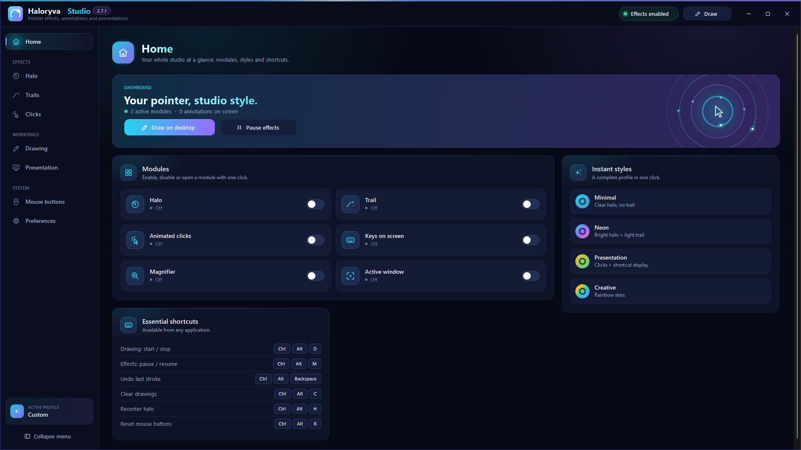

# Haloryva Studio 2.7.2

[Français](../fr/README.md) · [Home](../../README.md) · [Español](../es/README.md)

**2.7.2 is being prepared:** the code is based on the validated exp4 build, but the final release build, its native tests and Store certification for 2.7.2 still need confirmation. The last documented public release is 2.7.1. [Validation status](../VALIDATION-2.7.2.md).

Make your pointer easy to follow and annotate your screen during presentations.

Haloryva Studio helps you guide attention during a demo, a lesson or a presentation. Customize the pointer halo, trails and click effects, then draw directly on your screen.

Choose from ten tools: pen, highlighter, line, rectangle, ellipse, arrow, freehand arrow, auto shapes, number and text. Adjust color, thickness and smoothing, undo or redo a stroke, and export your annotations as a PNG with a transparent background.

Assign actions to your mouse buttons for both short clicks and long presses. Choose which drawing tools the buttons cycle through: select two favorites to switch between them without cycling through the full list.

The Studio brings together presentation settings, a magnifier, a focus effect and shortcut display. Profiles are saved locally and can be exported or imported as JSON. After you close the Studio window, the app can remain available from its icon near the clock.

Choose French, English or Spanish in the preferences. Your choice is saved and takes effect the next time you start the app.

Interface in French, English and Spanish.
Customizable pointer halo, trails and click effects.
Ten annotation tools, smoothing and assisted shapes.
A personal selection of tools to cycle through with mouse buttons.
Short-click and long-press actions; undo and redo.
PNG annotation export and saved settings profiles.

The 2.7.2 preparation adds continuous Line / Light trails, adaptive curves, progressive fading and explained settings. The exp4 visual trial was positive; this does not guarantee perfect smoothness on every device.

© 2026 Julien Lecomte — All rights reserved.

**Download:** [Microsoft Store](https://apps.microsoft.com/detail/9NJ14SZJP55B) remains the main free distribution channel. The offered version depends on rollout, country and device; 2.7.2 has not yet been submitted or certified. No 2.7.2 EXE is offered here.

[Installation](INSTALLATION.md) · [Support](SUPPORT.md) · [Privacy](../confidentialite/en.md) · [Release notes](NOUVEAUTES.md)

*Actual screenshot from version 2.7.1, kept as a historical illustration. It is not a screenshot or publication proof for 2.7.2.*
