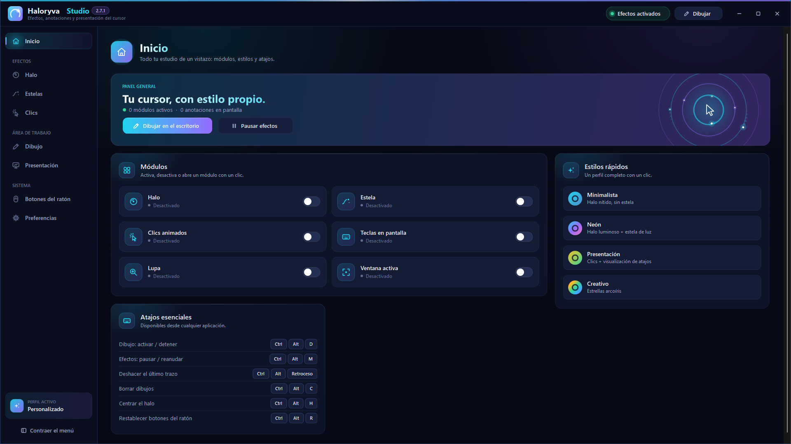

# Haloryva Studio 2.7.1

[Français](../fr/README.md) · [English](../en/README.md) · [Inicio](../../README.md)

Haz que tu cursor sea fácil de seguir y anota en pantalla durante tus presentaciones.

Haloryva Studio te ayuda a guiar la atención durante una demostración, una clase o una presentación. Personaliza el halo del cursor, las estelas y los efectos de clic, y dibuja directamente en la pantalla.

Elige entre diez herramientas: lápiz, resaltador, línea, rectángulo, elipse, flecha, flecha a mano alzada, formas automáticas, número y texto. Ajusta el color, el grosor y el suavizado, utiliza las opciones de deshacer y rehacer y exporta tus anotaciones como PNG con fondo transparente.

Asigna acciones a los botones del ratón para clics cortos y pulsaciones largas. Elige las herramientas de dibujo que recorrerán los botones: selecciona dos favoritas para alternar entre ellas sin pasar por toda la lista.

El Studio reúne los ajustes de presentación, una lupa, un efecto de enfoque y la visualización de atajos. Los perfiles se guardan localmente y se pueden exportar o importar en formato JSON. Al cerrar la ventana del Studio, puedes seguir accediendo a la aplicación desde su icono junto al reloj.

Elige francés, inglés o español en las preferencias. La selección se guarda y se aplica la próxima vez que inicies la aplicación.

Interfaz en francés, inglés y español.
Halo del cursor, estelas y efectos de clic personalizables.
Diez herramientas de anotación, suavizado y formas asistidas.
Selección personal de herramientas para recorrer con los botones del ratón.
Acciones de clic corto y pulsación larga; deshacer y rehacer.
Exportación de anotaciones a PNG y perfiles de ajustes guardados.

© 2026 Julien Lecomte — Todos los derechos reservados.

**Disponibilidad:** la 2.7.1 está disponible gratis en Microsoft Store. Ficha pública accesible en Francia el 14 de noviembre de 2026; disponibilidad según el país y el dispositivo. No se ofrece un EXE 2.7.1.

[Instalación](INSTALLATION.md) · [Soporte](SUPPORT.md) · [Privacidad](../confidentialite/es.md) · [Novedades](NOUVEAUTES.md)

