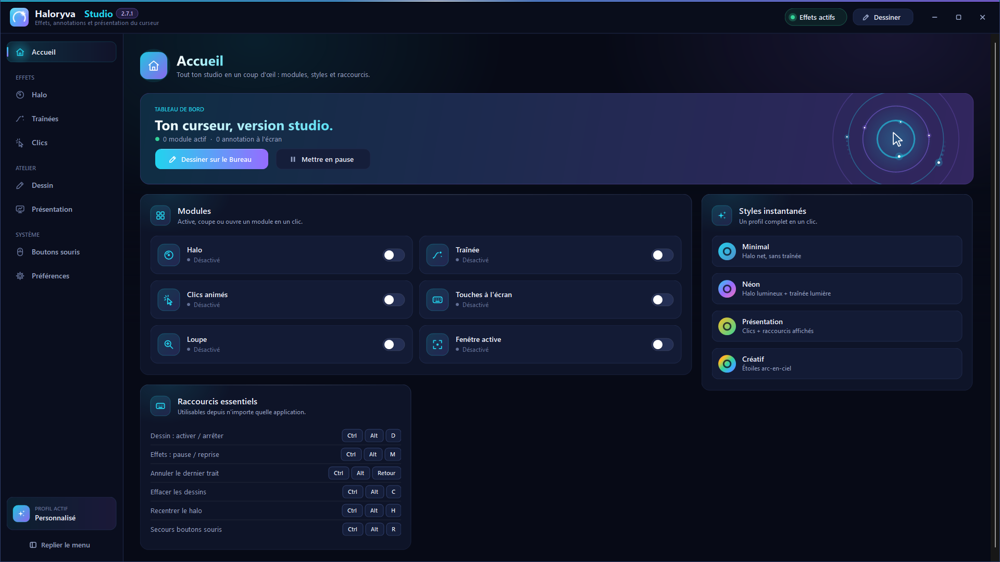

# Haloryva Studio 2.7.1

[Accueil](../../README.md) · [English](../en/README.md) · [Español](../es/README.md)

Rendez votre curseur visible et annotez votre écran pendant vos présentations.

Haloryva Studio vous aide à guider le regard pendant une démonstration, un cours ou une présentation. Personnalisez le halo du curseur, ses traînées et les effets de clic, puis dessinez directement sur votre écran.

Choisissez parmi dix outils : stylo, surligneur, ligne, rectangle, ellipse, flèche, flèche libre, auto-formes, numéro et texte. Ajustez la couleur, l'épaisseur et le lissage, annulez ou rétablissez un trait, puis exportez vos annotations en PNG sur fond transparent.

Attribuez des actions aux boutons de votre souris, avec un appui court et un appui long. Sélectionnez les outils que vous souhaitez parcourir : deux outils favoris suffisent pour alterner entre eux, sans parcourir toute la liste.

Le Studio rassemble les réglages de présentation, la loupe, le focus et l'affichage des raccourcis. Les profils s'enregistrent localement et peuvent être exportés ou importés au format JSON. L'application peut rester accessible depuis son icône près de l'horloge lorsque vous fermez le Studio.

Choisissez le français, l'anglais ou l'espagnol dans les préférences. Votre choix est mémorisé et s'applique au prochain lancement de l'application.

Interface en français, anglais et espagnol.
Halo du curseur, traînées et effets de clic personnalisables.
Dix outils d'annotation, lissage et formes assistées.
Liste personnelle des outils parcourus par les boutons.
Actions par appui court ou long ; annuler et rétablir.
Export PNG des annotations et sauvegarde des profils.

© 2026 Julien Lecomte — Tous droits réservés.

**Disponibilité :** la 2.7.1 est certifiée et accessible au groupe privé. Le téléchargement public n’est pas encore ouvert. Aucun EXE 2.7.1 proposé ici.

[Installation](INSTALLATION.md) · [Assistance](SUPPORT.md) · [Confidentialité](../confidentialite/fr.md) · [Nouveautés](NOUVEAUTES.md)

